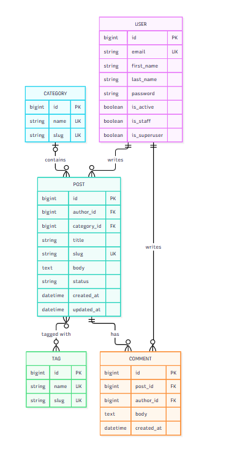

# Blog API

A blog REST API built with Django and Django REST Framework.

## ERD



## Setup

```bash
pip install -r requirements/dev.txt
python manage.py migrate
python manage.py seed
python manage.py createsuperuser
python manage.py runserver
```

Then open http://127.0.0.1:8000/admin/.

## Seeding

Fill the database with fake data:

```bash
python manage.py seed
```

| Argument     | Default | Description                                                   |
|--------------|---------|---------------------------------------------------------------|
| `--users`    | 20      | Number of users to create                                     |
| `--posts`    | 100     | Number of posts to create                                     |
| `--comments` | 500     | Number of comments to create                                  |
| `--clear`    | off     | Delete existing data before seeding (superusers are kept)     |

Example:

```bash
python manage.py seed --users 50 --posts 300 --comments 1500
```

```
Users:       50 created
Categories:   8 created
Tags:        20 created
Posts:      300 created
Comments:  1500 created
Done in 2.41 seconds
```

All seeded users share one password, defined by the `SEED_PASSWORD` constant in `apps/blog/constants.py`.
Running `seed` twice in a row is safe. See `python manage.py seed --help`.

## Admin

The admin is built with [Django Unfold](https://unfoldadmin.com/docs/): custom
sidebar, tabs, filters, bulk/row/detail actions, inline comments and a dashboard.

### Dashboard


### Post list with filters


### Post edit page


### User list


