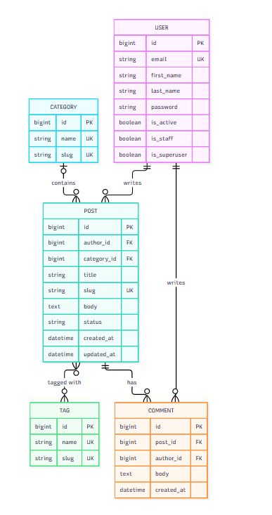

# Blog API

A blog REST API built with Django and Django REST Framework.

## ERD



## Setup

```bash
pip install -r requirements/dev.txt
python manage.py migrate
python manage.py seed
python manage.py createsuperuser
python manage.py runserver
```

Then open http://127.0.0.1:8000/admin/.

## Seeding

Fill the database with fake data:

```bash
python manage.py seed
```

| Argument     | Default | Description                                                   |
|--------------|---------|---------------------------------------------------------------|
| `--users`    | 20      | Number of users to create                                     |
| `--posts`    | 100     | Number of posts to create                                     |
| `--comments` | 500     | Number of comments to create                                  |
| `--clear`    | off     | Delete existing data before seeding (superusers are kept)     |

Example:

```bash
python manage.py seed --users 50 --posts 300 --comments 1500
```

```
Users:       50 created
Categories:   8 created
Tags:        20 created
Posts:      300 created
Comments:  1500 created
Done in 2.41 seconds
```

All seeded users share one password, defined by the `SEED_PASSWORD` constant in `apps/blog/constants.py`.
Running `seed` twice in a row is safe. See `python manage.py seed --help`.

Dates are realistic: every post gets a random date in the last 365 days, about 30% of the posts
are edited 1-30 days later, and every comment is created after its post.

## Admin

The admin is built with [Django Unfold](https://unfoldadmin.com/docs/): custom
sidebar, tabs, filters, bulk/row/detail actions, inline comments and a dashboard.

### Dashboard


### Post list with filters


### Post edit page


### User list


## Queries

`apps/blog/queries.py` has 50 ORM queries, one function for each. The `queries` command runs
them and shows the result and how many SQL queries each one sent:

```bash
python manage.py queries
```

| Option        | What it does                                                    |
|---------------|-----------------------------------------------------------------|
| (no option)   | Runs all queries except 40-44 (they change the data)            |
| `--number 31` | Runs only query 31. This works for 40-44 too                    |
| `--sql`       | Also prints the SQL that Django sent to the database            |

Example:

```bash
python manage.py queries --number 31
```

```
#31 categories_with_post_count — 1 SQL query
  Python {'post_count': 16}
  Databases {'post_count': 13}
  Frontend {'post_count': 13}
  Career {'post_count': 12}
  Django {'post_count': 11}
  (8 rows)
```

With `--sql` the SQL text is printed too:

```bash
python manage.py queries --number 6 --sql
```

```
#6 has_drafts — 1 SQL query
SELECT 1 AS "a" FROM "blog_post" WHERE "blog_post"."status" = 'draft' LIMIT 1
  True
```

Queries 40-44 change the data. To get fresh data, run `python manage.py seed --clear`.